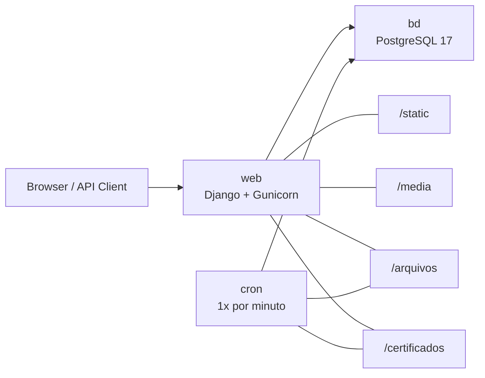

# eMensageria OpenSource

Sistema open source para mensageria do eSocial, com foco em operação local simples via Docker, persistência de arquivos e automação periódica de envio e consulta.

[](https://www.python.org/)
[](https://www.djangoproject.com/)
[](https://docs.docker.com/compose/)
[](https://www.postgresql.org/)
[](https://sonarcloud.io/summary/overall?id=emensageria_emensageria&branch=main)
[](https://sonarcloud.io/summary/overall?id=emensageria_emensageria&branch=main)

> Ambiente descrito neste README: uso local e desenvolvimento. As credenciais padrão `admin/admin` existem apenas para facilitar o bootstrap inicial.

## Visão Geral

- Stack local com apenas `web`, `cron` e `bd`.
- Bootstrap automático na primeira subida:
  - `migrate`
  - `collectstatic`
  - `create_superuser_if_none`
- Agendamento automático a cada 1 minuto no container `cron`:
  - `python manage.py esocial_consultar`
  - `python manage.py esocial_enviar`
- Persistência de `static`, `media`, `arquivos`, `certificados` e banco PostgreSQL via volumes Docker.

## Arquitetura Local



## Instalação via Docker

### Pré-requisitos

- Docker Engine ou Docker Desktop
- Docker Compose Plugin (`docker compose`)

### Subida rápida

1. Clone o repositório e entre na pasta do projeto:

```bash
git clone https://github.com/marcelomdevasconcellos/emensageria.git
cd emensageria
```

2. Construa as imagens e suba os serviços:

```bash
docker compose up --build -d
```

3. Aguarde o primeiro bootstrap terminar. Na primeira execução o container `web`:

```text
- aplica migrations
- coleta arquivos estáticos
- cria o superusuário padrão
- inicia o Gunicorn
```

4. Acesse a aplicação:

```text
URL:   http://localhost:8000/
Login: admin
Senha: admin
```

## Serviços

| Serviço | Função | Porta |
| --- | --- | --- |
| `web` | Django + Gunicorn | `8000` |
| `cron` | Execução agendada dos comandos eSocial | sem exposição externa |
| `bd` | PostgreSQL | `5432` |

## Comandos Úteis

### Subir ou atualizar a stack

```bash
docker compose up --build -d
```

### Ver logs da aplicação e do agendador

```bash
docker compose logs -f web cron
```

### Abrir shell no container web

```bash
docker compose exec web sh
```

### Executar comando Django manualmente

```bash
docker compose exec web python manage.py esocial_consultar
docker compose exec web python manage.py esocial_enviar
```

### Parar a stack

```bash
docker compose down
```

### Parar a stack e remover volumes

```bash
docker compose down -v
```

## Persistência de Dados

- `static`: preenchido por `collectstatic` e servido pela aplicação.
- `media`: armazenado em volume persistente e servido pela rota autenticada `/media/<path>`.
- `arquivos`: diretório operacional do sistema para comunicação e artefatos.
- `certificados`: armazenamento persistente para certificados.
- `pgdata`: persistência do banco PostgreSQL.

## Acessos Técnicos

| Recurso | Endereço |
| --- | --- |
| Aplicação | [http://localhost:8000/](http://localhost:8000/) |
| API token | [http://localhost:8000/api-token-auth/](http://localhost:8000/api-token-auth/) |
| SonarCloud | [Dashboard do projeto](https://sonarcloud.io/summary/overall?id=emensageria_emensageria&branch=main) |

## Qualidade, Testes e Cobertura

- O workflow [`test-coverage.yml`](.github/workflows/test-coverage.yml) executa a suíte com cobertura em cada `push` e `pull_request`.
- O percentual é extraído automaticamente do `coverage.json`, publicado no resumo do job e anexado como artefato junto com `coverage.xml`.
- O mesmo workflow envia a análise para o SonarCloud usando o secret `SONAR_TOKEN`.
- O badge de cobertura no topo deste README passa a refletir o branch `main` somente depois que a análise do GitHub Actions concluir com sucesso no SonarCloud.
- O projeto SonarCloud deve permanecer em modo de análise por CI. Se o autoscan estiver ativo, a métrica `coverage` não será publicada.
- Para este repositório, o objetivo recomendado para novas mudanças é manter cobertura máxima possível, idealmente `100%` nos cenários adicionados ou alterados.
- Configure o secret do repositório em `Settings > Secrets and variables > Actions > New repository secret` com o nome `SONAR_TOKEN`.
- O dashboard oficial pode ser acessado em:

```text
https://sonarcloud.io/summary/overall?id=emensageria_emensageria&branch=main
```

## Observações Operacionais

- O ambiente Docker local já sobe com variáveis padrão suficientes para uso imediato.
- O `cron` não precisa de configuração manual adicional para iniciar os comandos periódicos.
- O usuário padrão `admin/admin` é criado somente se ainda não existir superusuário.
- Este setup é voltado para desenvolvimento local. Para produção, revise credenciais, hosts permitidos, TLS, certificados e política de segredos.

## Autor

- Marcelo Medeiros de Vasconcellos
- LinkedIn: [marcelomdevasconcellos](https://www.linkedin.com/in/marcelomdevasconcellos/)
- E-mail: [adm@emensageria.com.br](mailto:adm@emensageria.com.br)

## Licença

Distribuído sob a licença `AGPL-3.0`. Veja [LICENSE](LICENSE) para detalhes.

## Referências

- Site oficial: [www.emensageria.com.br](https://www.emensageria.com.br/)
- SonarCloud: [emensageria_emensageria / main](https://sonarcloud.io/summary/overall?id=emensageria_emensageria&branch=main)


<!-- Security scan triggered at 2026-09-04 13:02:18 -->